<h1 align="center">Crownfall</h1>

<p align="center"><b>A 3D medieval realm where the eight great houses are memecoins, on NEAR.</b></p>

<p align="center">
  <a href="https://crownfall.nerom.site"><b>Play it</b></a> ·
  <a href="https://testnet.nearblocks.io/address/crownfall-vael.testnet">Contract on NEAR testnet</a> ·
  <a href="#for-judges-try-it-in-ten-minutes">Try it in ten minutes</a> ·
  <a href="#what-happens-on-near">How the chain side works</a> ·
  <a href="#run-it">Run it</a>
</p>

<p align="center">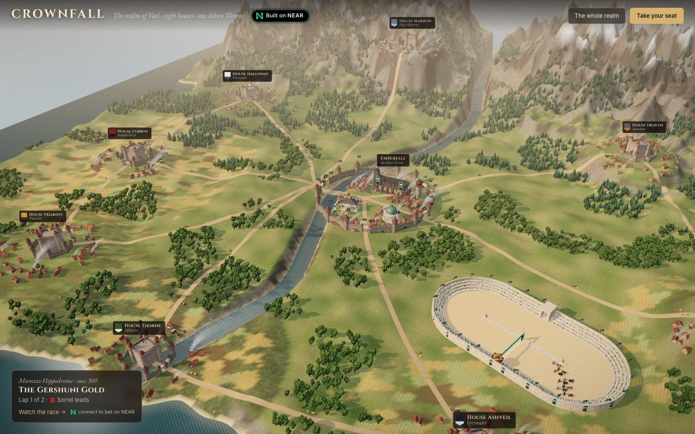</p>

Ride a chariot across Vael, walk into any house's hall and play its game, back a team at the Hippodrome, and earn the
seven seals that put you on the Ashen Throne. Every round you play burns that house's coin on NEAR, so playing is what
moves the price. Each house is a merchant: a rush of buying makes its coin dear, a flood of selling makes it cheap,
and a run on a house shuts its hall until its players buy back in.

- **Play:** https://crownfall.nerom.site. It runs on NEAR testnet. Sign in with Google or just a name and the realm
  makes you a real NEAR account: no wallet, no seed phrase, no popups.
- **Contract:** [`crownfall-vael.testnet`](https://testnet.nearblocks.io/address/crownfall-vael.testnet) (Rust, near-sdk 5, [`chain/`](chain/src/lib.rs))
- Built for the NEAR HACKATHON, November 2026, in four tracks ([see below](#hackathon-tracks)). The same team's
  other entry is [Parallax](https://github.com/neromtoobad/parallax), a company of AI agents that bid for work. The two
  projects are independent: no shared code or contracts.

<table>
  <tr>
    <td width="50%">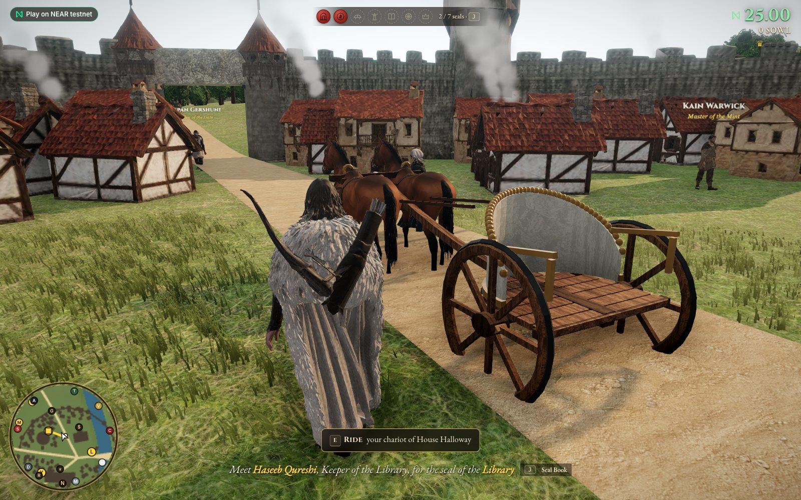</td>
    <td width="50%">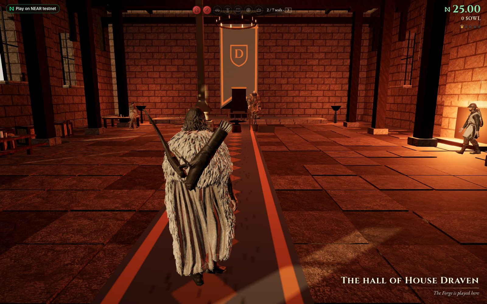</td>
  </tr>
  <tr>
    <td>The capital. Your lord, your chariot, the Mint ahead.</td>
    <td>Every keep has a hall you can walk into. This is House Draven's, at Stonedeep.</td>
  </tr>
</table>

## For judges: try it in ten minutes

You don't need a wallet. Sign in with Google (or type a name) and the realm makes you a NEAR testnet account,
`yourname-x7k2.vael.testnet`, with 0.5 testnet NEAR in it, enough for every step below. Its key stays in your
browser, so nothing ever pops up. A NEAR testnet wallet works too, from the same dialog. Every call below is on
testnet; you can watch them land on
[`crownfall-vael.testnet`](https://testnet.nearblocks.io/address/crownfall-vael.testnet) as you go.

| Do this | You'll see |
|---|---|
| **1.** Open https://crownfall.nerom.site | The realm of Vael from above: eight keeps, the capital, and a live race card bottom left. |
| **2.** Press **Sign in & take your seat**, then **Sign in**: **Continue with Google**, or type a name and press **Make my lord**. Pick a house, a lord and a name, press **Enter** | A few seconds later you're a real account on NEAR testnet (`ada-x7k2.vael.testnet`, or `ada.vael.testnet` for a name), shown in the pill top left. You land in the capital, Emberfall. (With a wallet instead, it asks once to add a game key: a function-call key limited to this contract with a 0.5 NEAR gas allowance.) |
| **3.** Walk to the Mint just ahead (the counter with the big coin) and press **E**: **Trade** | The eight house coins with buy and sell price, supply, reserve and coin burned, read from the contract. Press **Why this price?** under a coin for the merchant's reasons in plain words, and **▶▶ Fast-forward a week** to watch a simulated week of traders, whales and runs under the same rule in a few seconds. |
| **4.** Pick a house's coin, type `0.1`, press **Buy with 0.1 NEAR** | `buy` signs right there, with no popup (a wallet would ask). The coin lands in your purse (top right), and the pill top left shows **✓ … on NEAR**, linked to the transaction. |
| **5.** Press **M** for the map and tap that house's keep to set a waypoint. Press **C** to whistle for your chariot and **E** to take the reins | The radar draws the road route to the keep. **W** to drive, **A**/**D** to steer, **Space** to whip. |
| **6.** At the keep's lit door press **E** (**Enter**), walk to the table, press **E** (**Play**), then **Play** on the card | No popup: `enter` is signed in the browser, and it burns 400 of that house's coin. Back at the Mint, that coin's burned count has gone up, and its price with it. |
| **7.** Play the round (each game shows its controls) | The round closes with `finish`. The burn was already your favour with the house; a win marks the hall won for the Wardens' seals and goes on the house's tally of wins. In the Vintner's Cups (Vinehold) and Lantern Signals (Greywater) the contract judges the win itself: it rolled the round's seed at `enter`, and replays your moves against it. In Qureshi's Library it rolls the dice and settles the bet. See [What happens on NEAR](#what-happens-on-near). |
| **8.** Drive to the Mumtaz Hippodrome (**H** on the radar). At the stables press **E** (**Race**), then **Watch and bet on NEAR**. While the teams parade, choose a stake and press **Back** on one | `bet` puts your NEAR on that team (a wallet would ask to confirm). At the off the browser starts the race (`start_race`): only now is its seed drawn, from that block. In the first 40 seconds of the run, **Crack the whip** burns 200 of your team's coin (`whip`). |
| **9.** Watch to the line | The card reads **Settled on NEAR**: `settle` re-ran the race inside the contract ([`sim.rs`](chain/src/sim.rs)) and got the same finish you watched. A winning ticket shows **Collect** (`claim_race`). |
| **10.** Press **J** for the Seal Book and follow the objective line to the Wardens | Each trial you finish writes a seal to your account with `seal`; the contract checks the ones it can see (coin bought, hall wins, a bet at the Hippodrome). |
| **11.** Ride to the throne hall in the capital (**♛** on the radar), go in, walk the red runner and stand at the foot of the Ashen Throne | Every house ranked by this season's favour (yours is marked), the season clock and the crown pool, all read from the contract. |

**Check the chain directly.** These read-only calls need no account:

```bash
near contract call-function as-read-only crownfall-vael.testnet get_realm json-args {} network-config testnet now
near contract call-function as-read-only crownfall-vael.testnet get_account json-args '{"account":"YOUR_ACCOUNT.testnet"}' network-config testnet now
```

**Seasons.** A season lasts 24 hours on the contract clock. Enter the hall of the Ashen Throne in the capital (**♛**
on the radar, **E**: **Enter**) and stand at the foot of the throne (**E**: **Stand**) to see this season's favour by house, the time left and the crown pool. Once the time is
up, anyone there can press **Crown the house with the most favour** (`end_season`), and the next time you come in, the
last season's result is at the top with **Take your share** (`claim_crown`) if you played for the crowned house. What
you'd be paid is read first with `get_crown`, so the button shows the exact amount.

**Rather not sign in?** Press **Practice without signing in** in the seat picker: everything plays on a practice
purse kept in your browser, and nothing goes on chain.

**On a phone.** Turn it sideways. The left thumb is the joystick, drag on the right to look, and the buttons on the
right are Use, Run, Chariot and Map. Each hall game has its own touch buttons.

## Hackathon tracks

| Track | What Crownfall does for it | Where to look |
|---|---|---|
| **Memecoins With Mechanics** | Eight house coins, each priced by its house as a merchant: fair value is the NEAR reserve ÷ supply, and recent demand moves the asking price between ×0.7 and ×1.5. Sellers never get more than fair value, so every holder can always be paid, and a run that drains a house's purse shuts its hall until buyers bring it back. The whole rule is one file, and the Mint explains every price it shows. The meme is the mechanic: the only way to play a house's hall game is to burn its coin, so every round played lifts the price for everyone who holds that house. Whips at the races burn coin too, and 2% of every trade feeds the crown pool. The coins are NEP-245 multi-tokens (`mt_transfer`, `mt_transfer_call`, `mt_balance_of`, with `mt_mint`/`mt_burn`/`mt_transfer` events), so they move between wallets and contracts like any NEAR token. | [`chain/src/market.rs`](chain/src/market.rs) (the pricing rule) and its mirror [`web/src/chain/market.ts`](web/src/chain/market.ts), [`chain/src/lib.rs`](chain/src/lib.rs) (`buy`, `sell`, `enter`, `whip`, the `mt_*` methods), the Mint panel in [`web/src/PlayHud.tsx`](web/src/PlayHud.tsx), the week simulator [`web/src/chain/week.ts`](web/src/chain/week.ts) |
| **Games With Real Economies** | A 3D realm with nine hall games, a story of seven trials and chariot racing. Rounds cost real coin, two hall games are judged by the contract from a seed it rolls, the Library is a NEAR wager whose dice the contract rolls and settles itself, and races take pari-mutuel NEAR bets settled by running the race inside the contract. Four rival agents with their own wallets bet, whip and burn against you, deciding with a model on NEAR AI Cloud. The chain stays in the background: sign in with Google (or just a name) and the realm makes you a NEAR account whose key lives in your browser, so buying, betting, rounds and whips never pop anything up. A wallet works too. | [`agents/rivals.mjs`](agents/rivals.mjs), [`web/src/games/`](web/src/games/) (`host.ts` is the round lifecycle), [`web/src/realm/missions.ts`](web/src/realm/missions.ts), [`chain/src/sim.rs`](chain/src/sim.rs) + [`web/src/realm/raceSim.ts`](web/src/realm/raceSim.ts), [`web/api/lord.ts`](web/api/lord.ts) (social login), [`web/src/chain/near.ts`](web/src/chain/near.ts) (signing) |
| **Social Money** | Each house is a community with a shared treasury and reward rules. The crown pool collects 2% of every trade and the Gate's toll. When the season ends the house its players lifted highest is crowned, and the pool is split among that house's players by the favour they earned. | [`chain/src/lib.rs`](chain/src/lib.rs) (`add_favour`, `end_season`, `claim_crown`), the crown test in [`chain/src/tests.rs`](chain/src/tests.rs) |
| **Open Innovation** | A memecoin market you walk through: the price chart is a living realm, trading is a trip to the Mint, and the leaderboard is a throne. The race that pays out is the same deterministic race you watch, checked bit for bit between Rust and TypeScript. | The whole repo; the race check is `sim_matches_js` in [`chain/src/tests.rs`](chain/src/tests.rs) |

## The story

The old king of Vael is dead and the Ashen Throne stands empty for one season: a giant's seat of ash-black iron on an
eight-sided dais at the far end of the throne hall in Emberfall, under a rose window, one side for each house, the houses' coin spilled down its steps
and their eight stones set in its crown (modelled in code in Blender: [`design/blender/throne.py`](design/blender/throne.py)). By the old law the crown goes to
whoever earns the seals of the **Seven Wardens** before the season ends. You arrive at the south gate with a borrowed
chariot and a house to swear to.

| Warden | Trial | Seal |
|---|---|---|
| Stepan Gershuni, Warden of the Gate | Drive the Greywater markers against the clock | Gate |
| Kain Warwick, Master of the Mint | Buy your house's coin, then play your own hall's game | Mint |
| Eddy Lazzarin, Keeper of the Bridge | Win the Vintner's Cups in House Velmont's cellar | Bridge |
| Avichal Garg, Keeper of the Lighthouse | Bring six ships in at House Ashveil's signal hall | Lighthouse |
| Haseeb Qureshi, Keeper of the Library | Beat him at Liar's Dice | Library |
| Mert Mumtaz, Master of the Hippodrome | Finish in the top four of a chariot race | Hippodrome |
| Illia Polosukhin, Founder of the Reach | Hold six seals, win in three halls, then win the Crown Race | Throne |

The Wardens are named for the hackathon's judges, with roles drawn from their work. We use their names and roles
only. The figures are our own characters, and every line they speak is in-world.

<table>
  <tr>
    <td width="50%">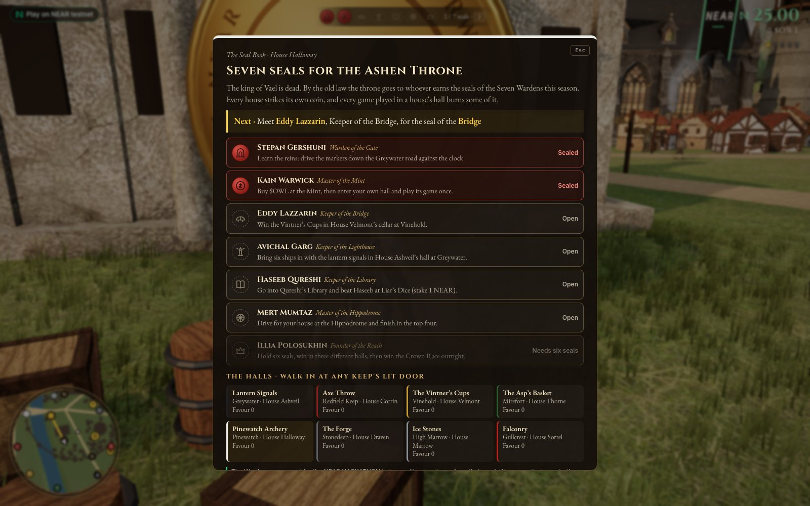</td>
    <td width="50%">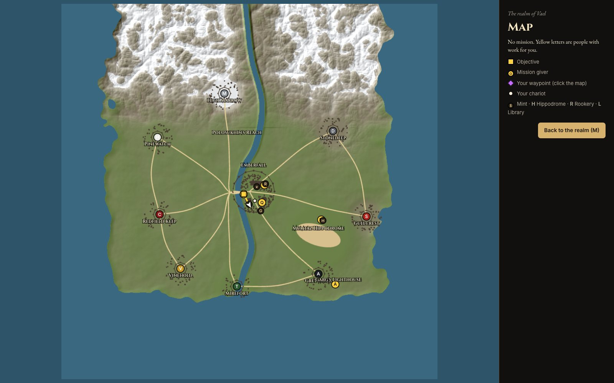</td>
  </tr>
  <tr>
    <td><b>The Seal Book</b> (J): every trial, every hall, what you've won.</td>
    <td><b>The map</b> (M): eight keeps, the capital, the Hippodrome.</td>
  </tr>
</table>

## The eight houses

Each house has a seat, a coin and a hall game.

| House | Seat | Coin | Hall game |
|---|---|---|---|
| Ashveil | Greywater | $HERON | Lantern Signals: repeat the ships' lantern signals |
| Corrin | Redfield Keep | $BOAR | Axe Throw |
| Velmont | Vinehold | $RAM | The Vintner's Cups: follow the ram under the goblets |
| Thorne | Mirefort | $ASP | The Asp's Basket: steal gold, freeze when it rises |
| Halloway | Pinewatch | $OWL | Pinewatch Archery: five arrows, mind the wind |
| Draven | Stonedeep | $BULL | The Forge: strike while the steel glows |
| Marrow | High Marrow | $LYNX | Ice Stones: slide and sweep to the mark |
| Sorrel | Gullcrest | $HAWK | Falconry: fly the hawk along the cliffs |

There's also **Liar's Dice** in Qureshi's Library (a NEAR wager the contract settles) and **chariot racing** at the Mumtaz Hippodrome.

### The hall games

<table>
  <tr>
    <td width="33%">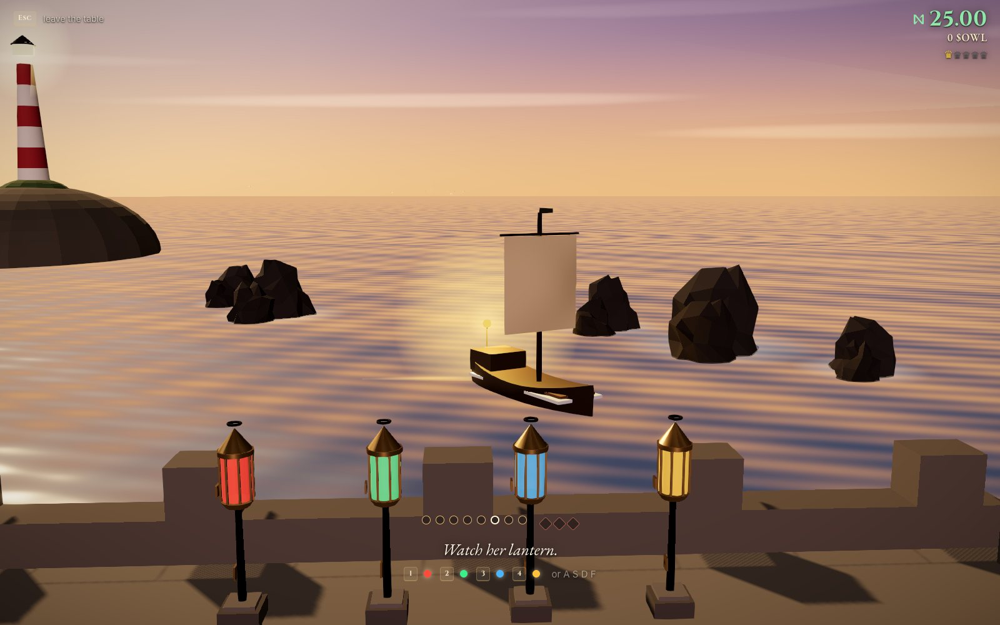</td>
    <td width="33%">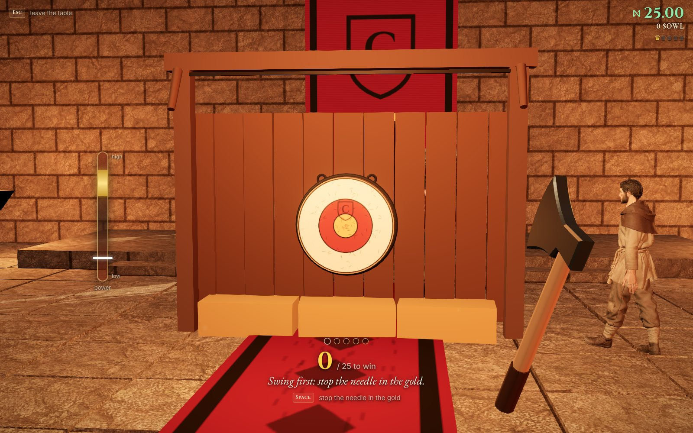</td>
    <td width="33%">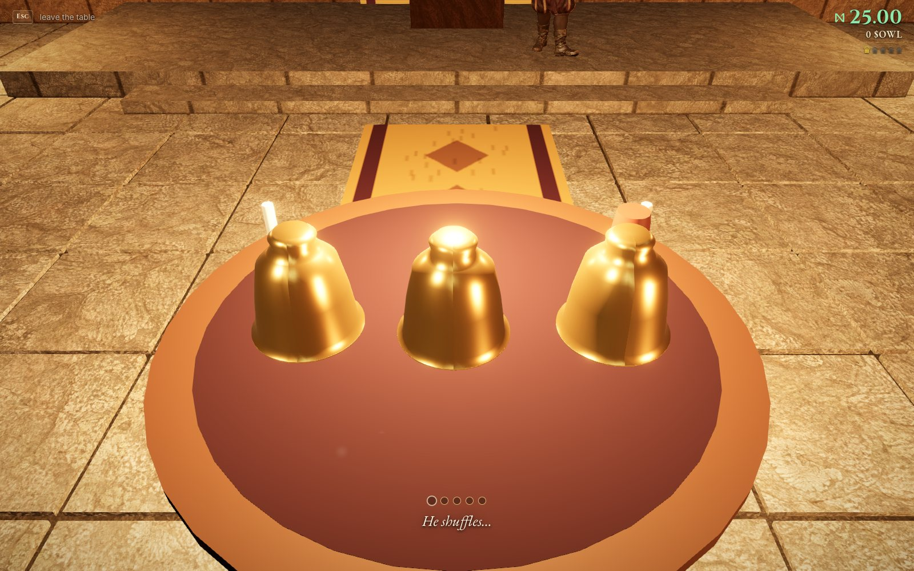</td>
  </tr>
  <tr>
    <td><b>Lantern Signals</b> · Ashveil · $HERON</td>
    <td><b>Axe Throw</b> · Corrin · $BOAR</td>
    <td><b>The Vintner's Cups</b> · Velmont · $RAM</td>
  </tr>
  <tr>
    <td>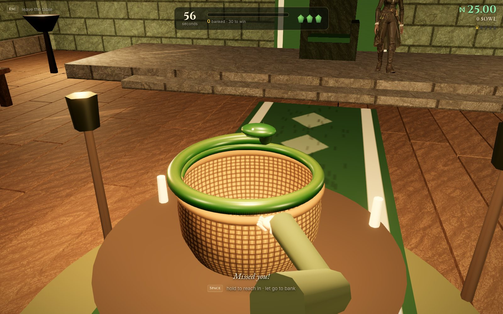</td>
    <td>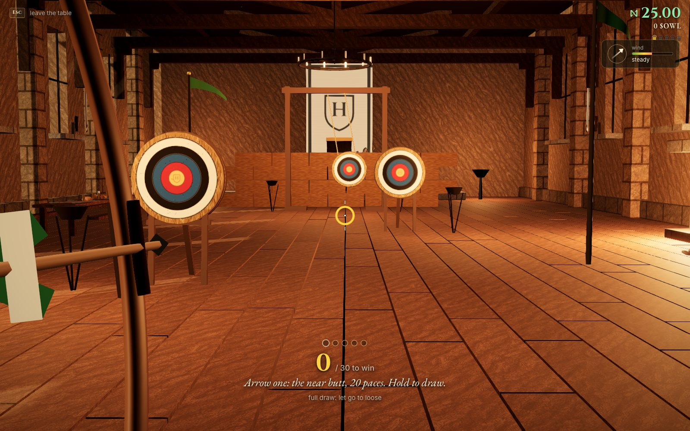</td>
    <td>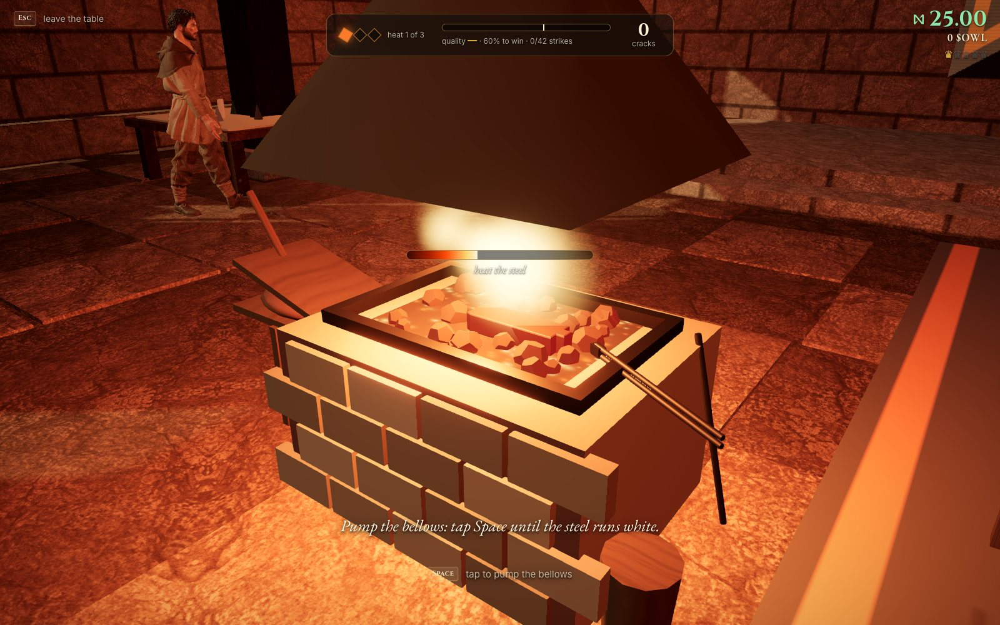</td>
  </tr>
  <tr>
    <td><b>The Asp's Basket</b> · Thorne · $ASP</td>
    <td><b>Pinewatch Archery</b> · Halloway · $OWL</td>
    <td><b>The Forge</b> · Draven · $BULL</td>
  </tr>
  <tr>
    <td>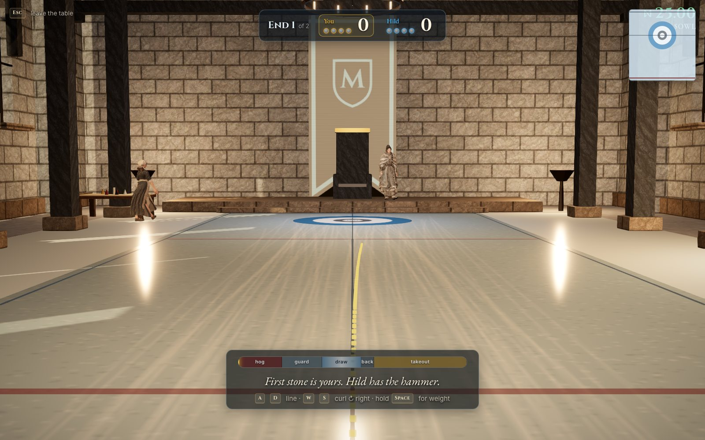</td>
    <td>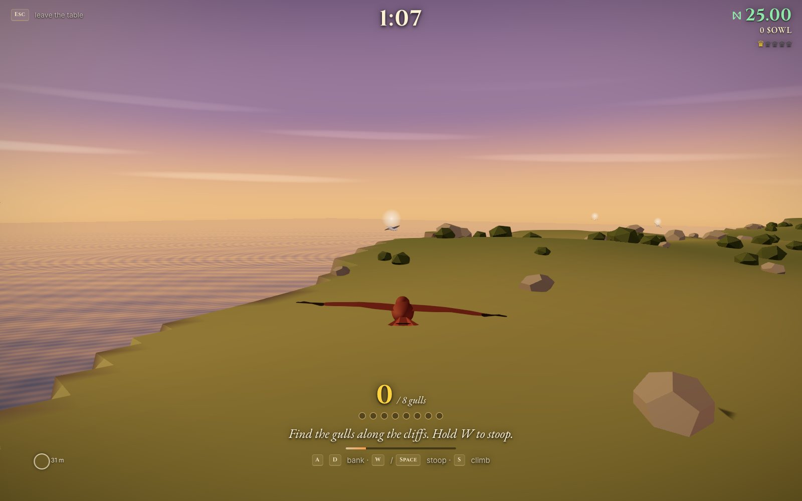</td>
    <td>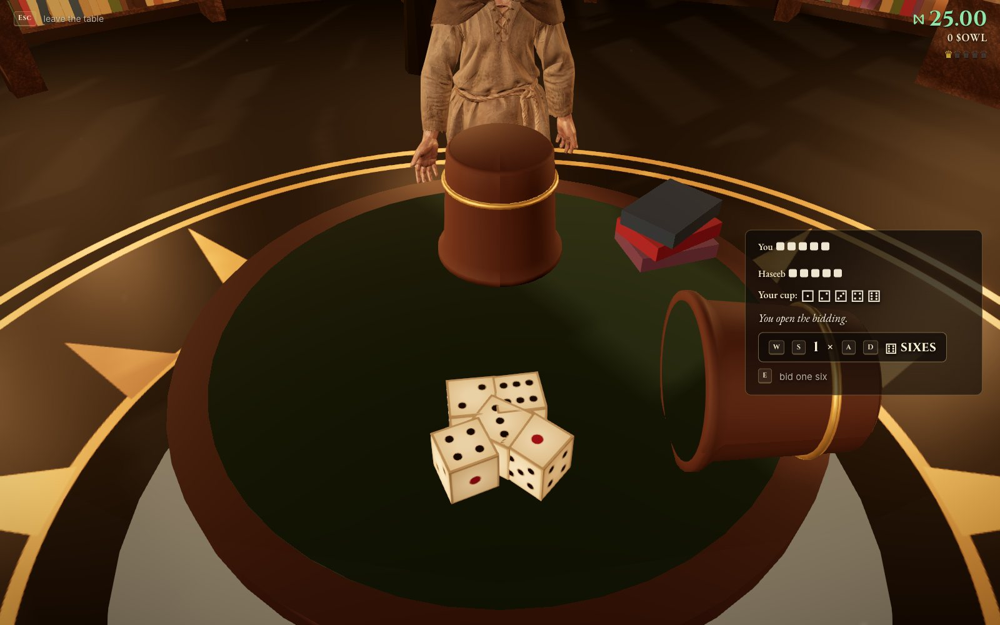</td>
  </tr>
  <tr>
    <td><b>Ice Stones</b> · Marrow · $LYNX</td>
    <td><b>Falconry</b> · Sorrel · $HAWK</td>
    <td><b>Liar's Dice</b> · the Library · 0.1 NEAR on chain</td>
  </tr>
</table>

Each game opens on a card that tells you what the round costs and what a win pays before you commit:

<p align="center">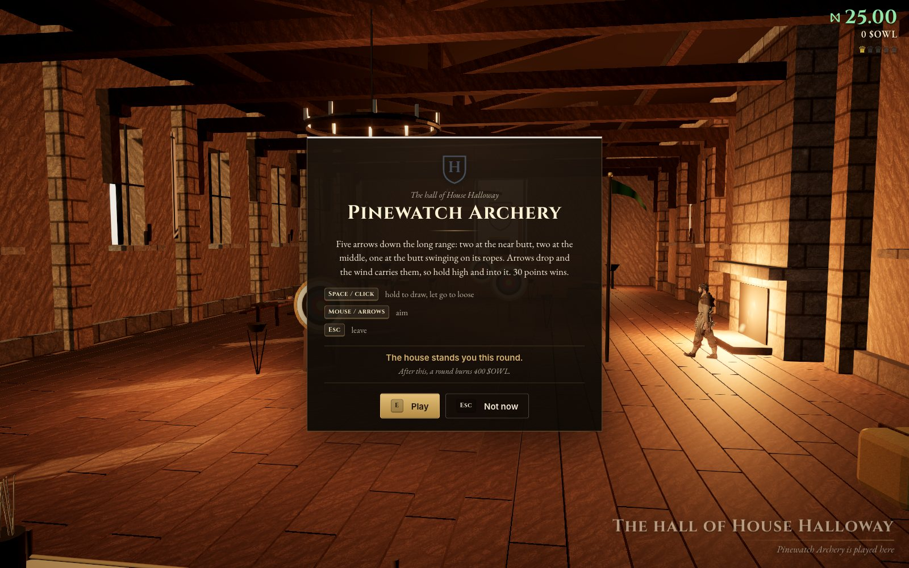</p>

## How to play

1. Open the site, look over the realm, and press **Sign in & take your seat**. Sign in with Google, or a name, or a
   NEAR testnet wallet, then pick a house, a lord and a name.
2. **WASD** to walk (Shift to run), **E** to talk, trade, enter and take the reins, **C** to whistle for your
   chariot, **Space** to crack the whip, **M** for the map, **J** for the Seal Book, **Esc** to pause.
   On a phone, turn it sideways: the left thumb is the joystick, drag on the right to look, and the buttons on the
   right are Use, Run, Chariot and Map.
3. Follow the objective line at the bottom of the screen. The Seal Book (J) lists every trial and every hall.

Signed in with Google or a name, everything signs in your browser with no popup. With a wallet, hall rounds, whips
and seals sign with the game key, and buying coin, staking and betting NEAR go through the wallet. Not ready to sign
in? **Practice without signing in** plays on a practice purse kept in your browser, and the pill at the top left
signs you in whenever you're ready.

<table>
  <tr>
    <td width="50%">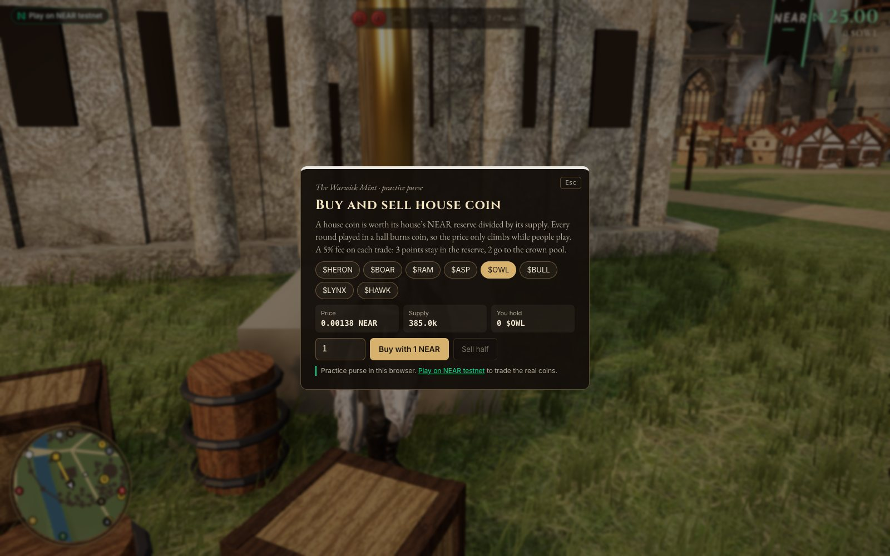</td>
    <td width="50%">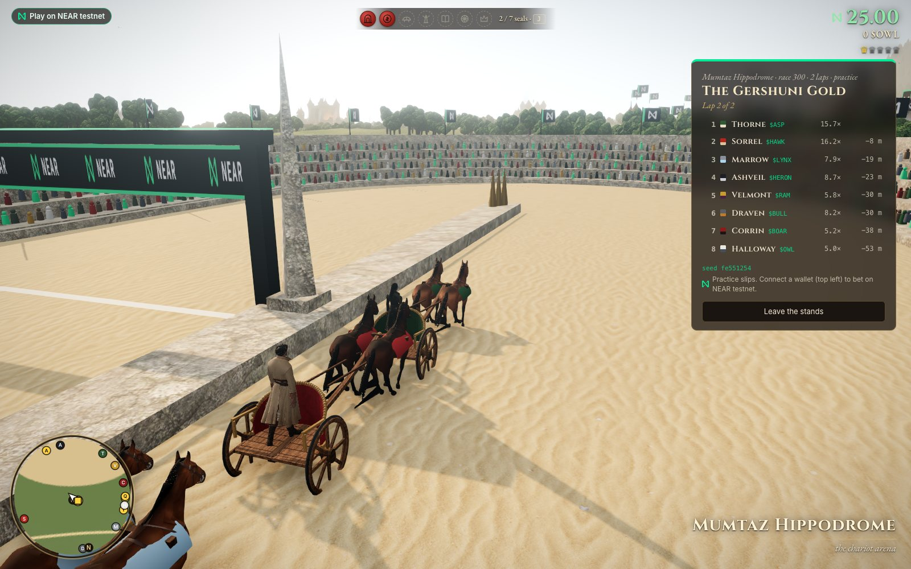</td>
  </tr>
  <tr>
    <td><b>The Mint.</b> Each coin's buy and sell price, supply, reserve and burn, read from the contract, and why it costs that.</td>
    <td><b>The Hippodrome.</b> Eight teams, pari-mutuel bets, three whips each, settled on chain.</td>
  </tr>
</table>

## What happens on NEAR

The realm's ledger is one contract, [`chain/`](chain/src/lib.rs).

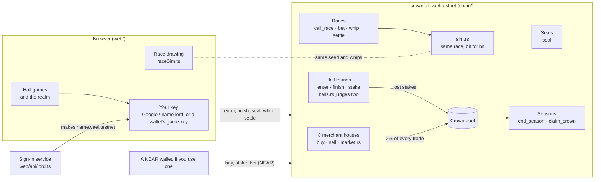

- **Eight houses, eight merchants.** Each house prices its own coin ([`market.rs`](chain/src/market.rs), the whole
  rule in one file):
  - **Fair value** is the house's NEAR reserve divided by its supply.
  - **Demand** is the NEAR bought (+) and sold (−) at the house lately. It halves every 20 minutes.
  - **The merchant's factor** is 1 + demand ÷ 1 NEAR, held between ×0.7 and ×1.5. A buyer pays fair value × the
    factor, so a rush of buying makes the coin dear, and what a buyer pays above fair value stays in the purse for
    every holder. A seller gets fair value × the factor but never more than fair value, so a flood of selling makes
    the coin cheap and the purse can always pay every holder in full.
  - **A run on the house.** The house remembers its fullest purse. If selling drains it below 70% of that, the house
    is broke and shuts: its hall takes no rounds and it buys no coin back. Every purchase while it's shut is an
    investment in reopening it, and at 85% of the old peak the doors open again. A rival sworn to a shut house
    invests to reopen it.
  - Every trade pays a 5% fee: 3 points stay in the reserve and 2 go to the crown pool.

  The Mint reads each house's `market` from `get_realm` and shows the buy and sell price with their factors; **Why
  this price?** spells out the reasons from the same numbers ([`market.ts`](web/src/chain/market.ts) mirrors the
  Rust line for line). **▶▶ Fast-forward a week** runs the same rule over a simulated week in the browser
  ([`week.ts`](web/src/chain/week.ts)): forty traders with different habits, three whales who rush a house and dump
  it, and the four rivals, with every run, shut and reopening marked on the chart. It is a simulation, not chain
  history.
- **Play to burn.** Every hall round burns that house's coin (`enter`: 400 coin, 500 at High Marrow). Burning shrinks
  supply against the same reserve, so every round played raises the price for everyone who holds that house. Coin
  burned is favour with the house, and it is the only favour there is.
- **The coins are NEP-245 tokens** on the realm contract, ids `heron`, `boar`, `ram`, `asp`, `owl`, `bull`, `lynx`
  and `hawk`: `mt_transfer`, `mt_batch_transfer`, `mt_transfer_call` (with `mt_resolve_transfer` refunding what the
  receiver hands back), `mt_balance_of`, `mt_supply`, `mt_metadata_*`, and the standard `mt_mint`, `mt_burn` and
  `mt_transfer` events on every buy, burn and move. Coin you're sent can be burned in a hall like any other; the
  favour stays with whoever burns it.
- **Two halls judged on chain.** In the Vintner's Cups (Velmont, hall 2) and Lantern Signals (Ashveil, hall 0)
  the round is played from a seed the contract rolls at `enter` from the block's randomness (it's in the `enter`
  event and in `hall_seed`). The browser draws every shuffle and every ship's lantern sequence from that seed with
  the same generator ([`halls.rs`](chain/src/halls.rs), mirrored in
  [`seeded.ts`](web/src/games/seeded.ts)), and `finish` sends your moves: the cup you lifted each round, or every
  lamp you answered. The contract replays the round and decides the win and its grade itself; a `won: true` with
  the wrong moves is a loss. Tests check a forged win is refused and a real one counts. What the chain still can't
  see is time: the seed is public once you've entered, so a script that reads it could play perfectly. The check
  stops a forged result, not a bot.
- **The Library.** On NEAR, Liar's Dice is one wager the contract settles by itself, so no browser can report this
  win. `stake` takes 0.01 to 1 NEAR (the site stakes 0.1) and rolls your five dice from that block's randomness; you
  see them in `get_library`. You make one bid, how many of one face lie under both cups, with `finish(round, …, bid)`.
  Haseeb's five dice are rolled from the block that takes the bid (it must be a later block than your stake), so
  neither side could know them. If both cups show at least your count, you're paid fair odds less 5%: the exact
  chance of at least k of a face among five dice is 4651, 1526, 276, 26 or 1 in 7776, so a bid needing one more pays
  1.59× and one needing three more pays 26.8×. Wins come from the Library's own bank and lost stakes go into it
  (`fund_library` tops it up; a bid can win at most half the bank). Walking out, or a round closed late, loses the
  stake. Only a win the contract decided marks the Library won, so the Library seal is earned on chain. (Practice mode
  keeps the full game of Liar's Dice against Haseeb.)
- **The seals** are kept per account, and the contract checks what it can see. The Mint seal needs a coin bought and
  a round played. The Bridge, Lighthouse and Library seals each need a won round in that hall, and all three of those
  wins are decided by the contract (the Cups, Signals and the Library). The Hippodrome seal
  needs a bet on one of the contract's races. The Throne needs the other six seals and wins in three halls. The
  Gate's trial is a drive, which the chain can't see, so its seal is paid for instead: a 0.01 NEAR toll from your
  account to the crown pool.
- **The Hippodrome.** Anyone can call a race (`call_race`). Bets are pari-mutuel in NEAR for 90 seconds, and the
  race has **no seed while betting is open**: at the off, the first `start_race` (or whip, or settle) draws it from
  that block's randomness. So nobody who bet could have run the race in advance, `preview_race` included. In the
  first 40 seconds from the start you can crack up to three whips for a team you've backed, each burning 200 of that
  house's coin. `settle` **runs the race inside the contract** ([`sim.rs`](chain/src/sim.rs)), the same
  deterministic simulation the browser draws ([`raceSim.ts`](web/src/realm/raceSim.ts)), so the race you watch is
  the race that pays out. A test checks the two match bit for bit over 40 races.
- **The Ashen Throne.** When a season ends, the house with the most favour is crowned (`end_season`). The crown pool
  is shared among that house's players in proportion to their favour (`claim_crown`). One caveat on season 1: it
  began under the first version of the contract, where a reported win added favour on top of the burn (up to double
  it). The upgrade to v2 kept that season's favour as it stood. From season 2 on, favour is coin burned and nothing
  else.
- **Nothing is left stranded.** Crown shares can be claimed until the next season ends; then what's left joins that
  season's pool. A race is deleted 100 races later, and whatever its winners never collected goes to the crown pool.
- **Storage is paid for.** A record a deposit opens (an account's first holding of a coin, its player record, its
  ticket for a race) costs a flat 0.0025 NEAR out of that deposit; a test checks no record, even for a 64-character
  account, outgrows it. Sending coin to someone who holds none of it takes 0.0025 NEAR for their new holding. The
  race book stays at 100 races.

**The rivals.** Four agent players live in the realm with their own testnet wallets, sworn to four houses:
Ser Odo Vane of Thorne ([`cf-odo-vael.testnet`](https://testnet.nearblocks.io/address/cf-odo-vael.testnet)), Lady
Isolde Marr of Marrow ([`cf-isolde-vael.testnet`](https://testnet.nearblocks.io/address/cf-isolde-vael.testnet)), Old
Bram of Halloway ([`cf-bram-vael.testnet`](https://testnet.nearblocks.io/address/cf-bram-vael.testnet)) and Nell the
Fox of Sorrel ([`cf-nell-vael.testnet`](https://testnet.nearblocks.io/address/cf-nell-vael.testnet)). They use the
same contract calls you do, and the contract treats them like any other player
([`agents/rivals.mjs`](agents/rivals.mjs)):

- **Bets.** While betting is open, each rival asks a model on NEAR AI Cloud whether to back a team and with how much,
  given the cup, the laps, the pools so far, its own house, its purse and its last six races. The answer is held to
  that rival's limits (Bram never stakes more than 0.08 NEAR). Without a model key it falls back to its own fixed
  rule and says so.
- **Whips.** Once the race starts and its seed is on chain, a rival that backed a team replays the race with the
  contract's `preview_race`, with and without one more whip, and cracks its whip only when it gains a place.
- **Chores.** Ser Odo calls each race, starts it at the off if no browser has, and settles it, so the Hippodrome runs
  on chain when nobody is watching. Winners collect.
- **Tribute.** About every twenty minutes each rival burns one entry in its own house's hall: favour for that house
  in the race for the Ashen Throne. It closes those rounds as lost, since it didn't play them.
- **Seasons and rescues.** When the season clock runs out, Ser Odo crowns the house with the most favour
  (`end_season`), and every rival collects its crown share. A rival whose house has been shut by a run buys back in
  to reopen it.

The race card lists the rivals' moves in the current race with their reasons, each one linked to its transaction.
They run on Railway around the clock; their feed is public at
[`crownfall-rivals-production.up.railway.app/feed`](https://crownfall-rivals-production.up.railway.app/feed)
(records, purses and the last 80 moves with transaction hashes). Their keys are full-access testnet keys, because
NEAR function-call keys can't attach the deposit a bet or a coin buy needs.

**Signing in without a wallet.** [`web/api/lord.ts`](web/api/lord.ts) is a small Vercel function that gives a player
a real NEAR testnet account under [`vael.testnet`](https://testnet.nearblocks.io/address/vael.testnet), funded from
that account, so the game never shows a seed phrase or a signing popup:

- **Google.** Google's own button returns a signed ID token. The function checks it with Google (audience, issuer,
  expiry), then derives the player's ed25519 key from the Google account id with an HMAC under a server secret, and
  makes `<first name>-<4 chars>.vael.testnet` with that key and 0.5 testnet NEAR. The same Google login finds the same
  account again on any device. Because the service can derive those keys, it is their custodian, the way a hosted
  wallet is. That's fine for testnet play money; on mainnet the key would come from an MPC or TEE signer instead.
- **Just a name.** The browser makes its own key and sends only the public half, with a small proof of work (about
  a second) so a script can't empty the purse. The function makes `<name>.vael.testnet` with that key and 0.4 testnet
  NEAR. The key never leaves the browser; lose the browser and you lose the account.

Either way the account holds a full-access key in your browser, and every call, payable or not, is signed there
([`web/src/chain/near.ts`](web/src/chain/near.ts)). The pill at the top left signs you out; the dialog offers
**Continue as** for accounts made in this browser.

**The game key.** When you connect a wallet, it adds one function-call key, limited to this contract and to `enter`,
`finish`, `seal`, `whip`, `call_race`, `start_race`, `settle`, `claim_race`, `claim_crown`, `end_season` and `sell`, with a
0.5 NEAR gas allowance. It can't send your NEAR anywhere except back to you. Anything that spends NEAR goes through
your wallet.

**What isn't proven on chain.** Six of the hall games (Axe Throw, the Asp's Basket, Archery, the Forge, Ice Stones,
Falconry) are skill games in your browser, and your own client reports the result (`finish`). A reported win there
moves no money and no favour: it counts toward the Throne's three hall wins and the house's tally of wins, nothing
else. The Cups and Signals are judged by the contract from its own seed (above), and the Library's dice are rolled
and its bid decided by the contract, so the Bridge, Lighthouse and Library seals are all earned on chain. Every NEAR that moves (the curve, burns, race results, the Library's bets, the Gate's toll,
the crown) is computed on chain.

| Call | Who signs | What it does |
|---|---|---|
| `buy(house)` / `sell(house, amount)` | wallet / game key | Trade a house coin with its merchant (a buy into a shut house is an investment toward reopening it) |
| `enter(house)` | game key | Burn the entry and open a hall round (shut houses take none); in the Cups and Signals, roll the round's seed |
| `stake()` | wallet | Put 0.01–1 NEAR on the Library table; your five dice are rolled from this block |
| `finish(round, won, grade, bid, play)` | game key | Close a round: hall won and win tally. In the Cups and Signals the contract replays `play` against the seed and decides; in the Library, settle the bid `[count, face]` against Haseeb's dice, rolled now |
| `fund_library()` | wallet | Add NEAR to the Library's bank |
| `seal(n)` | game key (the Gate: wallet, 0.01 NEAR toll) | Take a Warden's seal once its trial is met |
| `call_race()` / `bet(race, house)` | game key / wallet | Open a race; back a team in NEAR |
| `start_race(race)` | game key | At the off: draw the race's seed from this block |
| `whip(race, house)` | game key | Burn 200 coin to drive a team on |
| `settle(race)` / `claim_race(race)` | game key | Run the race on chain; collect a winning ticket |
| `end_season()` / `claim_crown(season)` | game key | Crown a house; take your share of the pool |
| `mt_transfer` / `mt_transfer_call` (and batch) | wallet | Send house coin (NEP-245) |

Views: `get_realm` (with each house's `market` and the pricing `rules`), `get_account`, `hall_seed`, `get_library`, `get_race`, `get_ticket`, `get_season`, `get_crown`, `quote_buy`, `quote_sell`, `preview_race`,
`version`, and NEP-245's `mt_balance_of`, `mt_batch_balance_of`, `mt_supply`, `mt_batch_supply`, `mt_token`,
`mt_metadata_contract`, `mt_metadata_base_by_token_id`, `mt_metadata_token_all`.

## Built with

- **Game:** Vite, React and three.js through react-three-fiber. The lords, the horses and the keeps are rigged and
  textured glTF models generated from our own character sheets. The chariot and the props are scripted in Blender
  ([`design/blender/`](design/blender/)).
- **Chain:** Rust and near-sdk 5.30 for the contract. The web side uses near-api-js for calls and
  [near-connect](https://github.com/hot-dao/near-connect) for wallets.
- **Sign-in:** Google Identity Services for the Google button, and a Vercel function with near-api-js that makes the
  accounts.
- **Hosting:** Vercel, at crownfall.nerom.site.

## Repo layout

| Path | What |
|---|---|
| `web/` | The game: Vite, React, three.js via react-three-fiber |
| `web/src/realm/` | The world: terrain, roads, keeps, halls, people, the player, races, missions |
| `web/src/games/` | The nine hall games and the round lifecycle (`host.ts`) |
| `web/src/chain/` | NEAR: sign-in dialog, wallet (near-connect), game key, contract calls, race polling |
| `web/api/lord.ts` | The sign-in service: Google or a name in, a funded `*.vael.testnet` account out |
| `chain/` | The contract, the race simulation and its tests |
| `agents/` | The four rival agents (`rivals.mjs`) and their feed |
| `contract/`, `sim/` | An earlier design (houses, decrees, councils), kept for reference and not deployed |
| `design/` | Design notes, the story, playtest audits |
| `docs/shots/` | The screenshots in this README |

## Run it

The game opens on http://localhost:5196.

```bash
cd web && npm install && npm run dev
```

The contract's tests include the race check against the browser sim.

```bash
cd chain && cargo test
```

```bash
cd chain && cargo near build non-reproducible-wasm
```

The live contract was upgraded in place from its first version: `migrate` keeps every holding, round, ticket and
season, reads old players and races as they are, and moves each over the next time it's touched (a test writes the
first version's state and upgrades it).

The rivals run with Node 20 or later. They read their keys from `~/.near-credentials/testnet` (or `RIVAL_<ID>_KEY`)
and their model key from `NEARAI_API_KEY`; `DRY=1` decides and logs without sending anything.

```bash
cd agents && npm install && DRY=1 node rivals.mjs
```

The web app talks to `crownfall-vael.testnet` by default. Set `VITE_CONTRACT` to point it at your own deployment
([`web/src/chain/near.ts`](web/src/chain/near.ts)).

The sign-in service runs inside the dev server too. Give it a parent account in `web/.env.local`: `VAEL_ACCOUNT`, its
key as `VAEL_KEY`, a random `LORD_SECRET`, and `GOOGLE_CLIENT_ID` (a Google OAuth web client with your origin
allowed) for the Google button. Without a Google client the dialog offers a name and a wallet.

## License

MIT, see [LICENSE](LICENSE).
