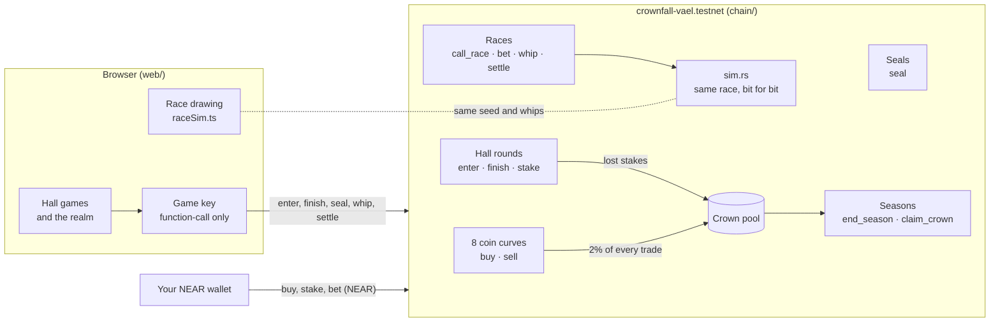

<h1 align="center">Crownfall</h1>

<p align="center"><b>A 3D medieval realm where the eight great houses are memecoins, on NEAR.</b></p>

<p align="center">
  <a href="https://crownfall.nerom.site"><b>Play it</b></a> ·
  <a href="https://testnet.nearblocks.io/address/crownfall-vael.testnet">Contract on NEAR testnet</a> ·
  <a href="#what-happens-on-near">How the chain side works</a> ·
  <a href="#run-it">Run it</a>
</p>

<p align="center"></p>

Ride a chariot across Vael, walk into any house's hall and play its game, back a team at the Hippodrome, and earn the
seven seals that put you on the Ashen Throne. Every round you play burns that house's coin on NEAR, so playing is what
moves the price.

- **Play:** https://crownfall.nerom.site. It runs on NEAR testnet, and you can try it without a wallet.
- **Contract:** [`crownfall-vael.testnet`](https://testnet.nearblocks.io/address/crownfall-vael.testnet) (Rust, near-sdk 5, [`chain/`](chain/src/lib.rs))
- Built for the NEAR HACKATHON, November 2026.

<table>
  <tr>
    <td width="50%"></td>
    <td width="50%"></td>
  </tr>
  <tr>
    <td>The capital. Your lord, your chariot, the Mint ahead.</td>
    <td>Every keep has a hall you can walk into. This is House Draven's, at Stonedeep.</td>
  </tr>
</table>

## The story

The old king of Vael is dead and the Ashen Throne stands empty for one season. By the old law the crown goes to
whoever earns the seals of the **Seven Wardens** before the season ends. You arrive at the south gate with a borrowed
chariot and a house to swear to.

| Warden | Trial | Seal |
|---|---|---|
| Stepan Gershuni, Warden of the Gate | Drive the Greywater markers against the clock | Gate |
| Kain Warwick, Master of the Mint | Buy your house's coin, then play your own hall's game | Mint |
| Eddy Lazzarin, Keeper of the Bridge | Win the Vintner's Cups in House Velmont's cellar | Bridge |
| Avichal Garg, Keeper of the Lighthouse | Bring six ships in at House Ashveil's signal hall | Lighthouse |
| Haseeb Qureshi, Keeper of the Library | Beat him at Liar's Dice | Library |
| Mert Mumtaz, Master of the Hippodrome | Finish in the top four of a chariot race | Hippodrome |
| Illia Polosukhin, Founder of the Reach | Hold six seals, win in three halls, then win the Crown Race | Throne |

The Wardens are named for the hackathon's judges, with roles drawn from their work. We use their names and roles
only. The figures are our own characters, and every line they speak is in-world.

<table>
  <tr>
    <td width="50%"></td>
    <td width="50%"></td>
  </tr>
  <tr>
    <td><b>The Seal Book</b> (J): every trial, every hall, what you've won.</td>
    <td><b>The map</b> (M): eight keeps, the capital, the Hippodrome.</td>
  </tr>
</table>

## The eight houses

Each house has a seat, a coin and a hall game.

| House | Seat | Coin | Hall game |
|---|---|---|---|
| Ashveil | Greywater | $HERON | Lantern Signals: repeat the ships' lantern signals |
| Corrin | Redfield Keep | $BOAR | Axe Throw |
| Velmont | Vinehold | $RAM | The Vintner's Cups: follow the ram under the goblets |
| Thorne | Mirefort | $ASP | The Asp's Basket: steal gold, freeze when it rises |
| Halloway | Pinewatch | $OWL | Pinewatch Archery: five arrows, mind the wind |
| Draven | Stonedeep | $BULL | The Forge: strike while the steel glows |
| Marrow | High Marrow | $LYNX | Ice Stones: slide and sweep to the mark |
| Sorrel | Gullcrest | $HAWK | Falconry: fly the hawk along the cliffs |

There's also **Liar's Dice** in Qureshi's Library (staked in NEAR) and **chariot racing** at the Mumtaz Hippodrome.

### The hall games

<table>
  <tr>
    <td width="33%"></td>
    <td width="33%"></td>
    <td width="33%"></td>
  </tr>
  <tr>
    <td><b>Lantern Signals</b> · Ashveil · $HERON</td>
    <td><b>Axe Throw</b> · Corrin · $BOAR</td>
    <td><b>The Vintner's Cups</b> · Velmont · $RAM</td>
  </tr>
  <tr>
    <td></td>
    <td></td>
    <td></td>
  </tr>
  <tr>
    <td><b>The Asp's Basket</b> · Thorne · $ASP</td>
    <td><b>Pinewatch Archery</b> · Halloway · $OWL</td>
    <td><b>The Forge</b> · Draven · $BULL</td>
  </tr>
  <tr>
    <td></td>
    <td></td>
    <td></td>
  </tr>
  <tr>
    <td><b>Ice Stones</b> · Marrow · $LYNX</td>
    <td><b>Falconry</b> · Sorrel · $HAWK</td>
    <td><b>Liar's Dice</b> · the Library · 1 NEAR</td>
  </tr>
</table>

Each game opens on a card that tells you what the round costs and what a win pays before you commit:

<p align="center"></p>

## How to play

1. Open the site, look over the realm, and press **Connect wallet & take your seat**. Connect a NEAR testnet
   wallet, then pick a house, a lord and a name. On the way in, your wallet asks once for the game key.
2. **WASD** to walk (Shift to run), **E** to talk, trade, enter and take the reins, **C** to whistle for your
   chariot, **Space** to crack the whip, **M** for the map, **J** for the Seal Book, **Esc** to pause.
3. Follow the objective line at the bottom of the screen. The Seal Book (J) lists every trial and every hall.

With the game key in place, hall rounds, whips and seals are signed without a popup. Buying coin, staking and betting
NEAR still go through your wallet. No wallet yet? **Practice without a wallet** plays on a practice purse kept in your
browser, and the pill at the top left connects one whenever you're ready.

<table>
  <tr>
    <td width="50%"></td>
    <td width="50%"></td>
  </tr>
  <tr>
    <td><b>The Mint.</b> Each coin's price, supply, reserve and burn, read from the contract.</td>
    <td><b>The Hippodrome.</b> Eight teams, pari-mutuel bets, three whips each, settled on chain.</td>
  </tr>
</table>

## What happens on NEAR

The realm's ledger is one contract, [`chain/`](chain/src/lib.rs).



- **Eight coins on curves.** A coin's price is its house's NEAR reserve divided by its supply. Buying adds NEAR and
  mints coin at that price; selling burns coin and pays NEAR back. Every trade pays a 5% fee: 3 points stay in the
  reserve, which lifts the price for holders, and 2 go to the crown pool.
- **Play to burn.** Every hall round burns that house's coin (`enter`: 400 coin, 500 at High Marrow). Burning shrinks
  supply against the same reserve, so every round played raises the price for everyone who holds that house. Burns
  earn favour with the house, and a won round earns more (`finish`).
- **The Library.** Liar's Dice is staked at 1 NEAR. Your first win pays the stake back doubled, with the bonus taken
  from the crown pool while it lasts. Later wins return the stake, and a lost stake goes to the crown pool.
- **The seals** are kept per account, and the contract checks what it can see. The Mint seal needs a coin bought and
  a round played. The Bridge, Lighthouse and Library seals each need a won round in that hall. The Throne needs the
  other six seals and wins in three halls.
- **The Hippodrome.** Anyone can call a race (`call_race`), seeded from the block's randomness. Bets are pari-mutuel
  in NEAR for 90 seconds. In the first 40 seconds of the run you can crack up to three whips for a team, each burning
  200 of that house's coin. `settle` **runs the race inside the contract** ([`sim.rs`](chain/src/sim.rs)), the same
  deterministic simulation the browser draws ([`raceSim.ts`](web/src/realm/raceSim.ts)), so the race you watch is
  the race that pays out. A test checks the two match bit for bit over 40 races.
- **The Ashen Throne.** When a season ends, the house with the most favour is crowned (`end_season`). The crown pool
  is shared among that house's players in proportion to their favour (`claim_crown`).

**The game key.** When you connect, your wallet adds one function-call key, limited to this contract and to `enter`,
`finish`, `seal`, `whip`, `call_race`, `settle`, `claim_race`, `claim_crown`, `end_season` and `sell`, with a
0.5 NEAR gas allowance. It can't send your NEAR anywhere except back to you. Anything that spends NEAR goes through
your wallet.

**What isn't proven on chain.** A hall game runs in your browser, and your own client reports the result (`finish`).
A false win can only add favour on top of coin you really burned. In the Library it can win back your own stake,
plus the doubled bonus once per account. Race results and every other payout are computed on chain.

| Call | Who signs | What it does |
|---|---|---|
| `buy(house)` / `sell(house, amount)` | wallet / game key | Trade a house coin on its curve |
| `enter(house)` | game key | Burn the entry and open a hall round |
| `stake()` | wallet | Put 1 NEAR on the Library table |
| `finish(round, won, grade)` | game key | Close a round: favour, wins, Library payout |
| `seal(n)` | game key | Take a Warden's seal once its trial is met |
| `call_race()` / `bet(race, house)` | game key / wallet | Open a race; back a team in NEAR |
| `whip(race, house)` | game key | Burn 200 coin to drive a team on |
| `settle(race)` / `claim_race(race)` | game key | Run the race on chain; collect a winning ticket |
| `end_season()` / `claim_crown(season)` | game key | Crown a house; take your share of the pool |

Views: `get_realm`, `get_account`, `get_race`, `get_ticket`, `get_season`, `quote_buy`, `quote_sell`, `preview_race`.

## Built with

- **Game:** Vite, React and three.js through react-three-fiber. The lords, the horses and the keeps are rigged and
  textured glTF models generated from our own character sheets. The chariot and the props are scripted in Blender
  ([`design/blender/`](design/blender/)).
- **Chain:** Rust and near-sdk 5.30 for the contract. The web side uses near-api-js for calls and
  [near-connect](https://github.com/hot-dao/near-connect) for wallets.
- **Hosting:** Vercel, at crownfall.nerom.site.

## Repo layout

| Path | What |
|---|---|
| `web/` | The game: Vite, React, three.js via react-three-fiber |
| `web/src/realm/` | The world: terrain, roads, keeps, halls, people, the player, races, missions |
| `web/src/games/` | The nine hall games and the round lifecycle (`host.ts`) |
| `web/src/chain/` | NEAR: wallet (near-connect), game key, contract calls, race polling |
| `chain/` | The contract, the race simulation and its tests |
| `contract/`, `sim/` | An earlier design (houses, decrees, councils), kept for reference and not deployed |
| `design/` | Design notes, the story, playtest audits |
| `docs/shots/` | The screenshots in this README |

## Run it

The game opens on http://localhost:5196.

```bash
cd web && npm install && npm run dev
```

The contract's tests include the race check against the browser sim.

```bash
cd chain && cargo test
```

```bash
cd chain && cargo near build non-reproducible-wasm
```

The web app talks to `crownfall-vael.testnet` by default. Set `VITE_CONTRACT` to point it at your own deployment
([`web/src/chain/near.ts`](web/src/chain/near.ts)).
